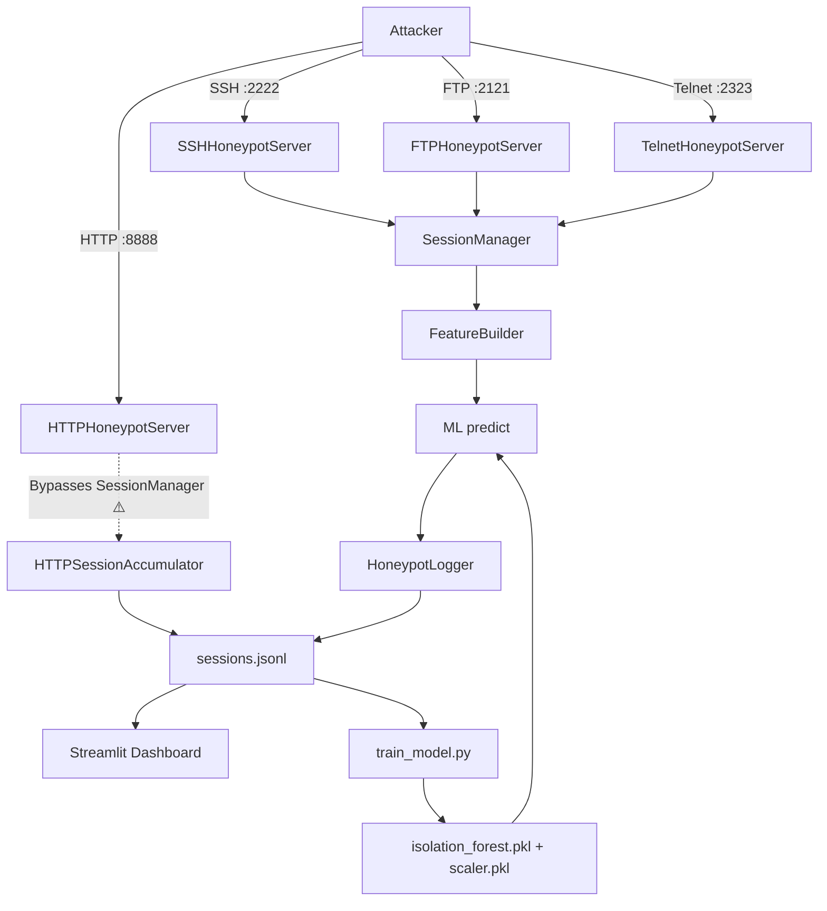

# 🔍 PhantomPot-v2 — Project Analysis & Improvement Roadmap

## Project Overview

PhantomPot-v2 is a **multi-protocol honeypot** with 4 listeners (SSH, HTTP, FTP, Telnet), an Isolation Forest ML anomaly detector, a Streamlit dashboard, and a KPI evaluation framework. The architecture is modular: shared `core/` services (logger, session manager, feature builder) feed a common JSONL log that the dashboard and ML pipeline consume.

---

## Architecture Diagram (Current State)



> [!WARNING]
> The HTTP honeypot **does not use** the shared `SessionManager` or `HoneypotLogger` — it writes directly to `sessions.jsonl` via its own `HTTPSessionAccumulator`. This is the single biggest architectural inconsistency in the project.

---

## Priority 1 — Critical Bugs & Inconsistencies

### 1.1 HTTP Honeypot Bypasses the Shared Pipeline

| File | Issue |
|------|-------|
| [http_server.py](file:///d:/Projects/VIT/PhantomPot-v2/src/http_honeypot/http_server.py) | `HTTPHoneypotServer` accepts `logger` and `session_manager` params but **never uses them** |
| [http_server.py](file:///d:/Projects/VIT/PhantomPot-v2/src/http_honeypot/http_server.py#L42-L107) | `HTTPSessionAccumulator` writes to the log file directly, bypassing thread-safe `HoneypotLogger` |
| [http_server.py](file:///d:/Projects/VIT/PhantomPot-v2/src/http_honeypot/http_server.py#L95) | Hardcodes `duration: 0.1` instead of computing actual duration |

**Impact:** HTTP sessions are never scored by the ML model, have no `anomaly`/`anomaly_score`/`severity` fields, and corrupt the dashboard's aggregate statistics.

**Fix:** Refactor `HTTPHoneypotServer` to integrate with `SessionManager` + `FeatureBuilder` + `predict_session_anomaly` the same way SSH, FTP, and Telnet do.

### 1.2 Duplicate `main()` Definition in Dashboard

| File | Line |
|------|------|
| [app.py](file:///d:/Projects/VIT/PhantomPot-v2/dashboard/app.py#L562-L567) | `def main()` is defined **twice** — lines 562 and 567 |

The first definition (lines 562-565) is dead code. Python uses the second definition. Harmless but sloppy.

### 1.3 Duplicate `_respond_dummy` Method

| File | Lines |
|------|-------|
| [http_server.py](file:///d:/Projects/VIT/PhantomPot-v2/src/http_honeypot/http_server.py#L314-L331) | First `_respond_dummy` with error handling |
| [http_server.py](file:///d:/Projects/VIT/PhantomPot-v2/src/http_honeypot/http_server.py#L404-L414) | Second `_respond_dummy` **without** error handling |

The second definition silently shadows the first. Connection-abort errors will crash the handler thread.

### 1.4 `PayloadAnalyzer` is Never Used

[payload_analyzer.py](file:///d:/Projects/VIT/PhantomPot-v2/src/http_honeypot/payload_analyzer.py) contains a sophisticated `PayloadAnalyzer` class with 40+ attack signatures (SQLi, path traversal, Log4Shell, SSTI, etc.) and a full normalization pipeline — but **nothing imports or calls it**. This is dead code.

### 1.5 `request_handler.py` is Never Used

[request_handler.py](file:///d:/Projects/VIT/PhantomPot-v2/src/http_honeypot/request_handler.py) has a complete `HTTPRequestHandler` class with raw-socket parsing and a routing table, but the HTTP server uses `http.server.BaseHTTPRequestHandler` instead. Another dead module.

---

## Priority 2 — Security Hardening

### 2.1 SSH Host Key in Version Control

The `.gitignore` has `config/*.key` and `config/*.pub`, but `config/ssh_host_rsa.key` and `.pub` **are already committed**. Anyone who clones the repo gets your private key, enabling MITM attacks against clients connecting to the honeypot.

**Fix:** Remove from git history (`git rm --cached config/ssh_host_rsa.key*`) and rely on auto-generation in `SSHHoneypotServer._load_or_create_host_key()`.

### 2.2 No Rate Limiting / Connection Throttling

All four servers have `listen(100)` and spawn unlimited threads per connection. A single attacker can DoS the honeypot with a SYN flood.

**Fix:** Add a `concurrent.futures.ThreadPoolExecutor` with a configurable max-workers cap, and optionally track connections-per-IP with a sliding window.

### 2.3 No Input Sanitization on Log Payloads

Attacker-controlled strings (usernames, passwords, commands) are written directly to JSONL. A crafted username like `"} malicious_field: true` could break downstream JSON parsers.

**Fix:** `json.dumps()` with `ensure_ascii=True` already handles this for `log_session`, but the `HTTPSessionAccumulator._finalize_session_unlocked` writes with bare `json.dumps(session)` — ensure consistency.

### 2.4 Hardcoded Fake Credentials in `request_handler.py`

[request_handler.py:95-102](file:///d:/Projects/VIT/PhantomPot-v2/src/http_honeypot/request_handler.py#L95-L102) serves `/.env` with fake database credentials. This is good honeypot bait, but should be configurable and rotatable so real attackers don't fingerprint PhantomPot by these exact strings.

---

## Priority 3 — ML Pipeline Improvements

### 3.1 Isolation Forest is Unsupervised — No Ground Truth Validation

The model uses `contamination=0.2` (assumes 20% of training data is anomalous), but there's no labeled data to validate against. The `KPIMetricsCollector` has `DetectionMetric` with ground-truth fields, but they're only populated by simulation scripts, never in production.

**Improvements:**
1. **Add a labeling mechanism** — a CLI tool or dashboard button to manually label sessions as attack/normal
2. **Retrain periodically** with the labeled data to create a semi-supervised pipeline
3. **Add model versioning** — timestamp each `.pkl` and track precision/recall across versions

### 3.2 Feature Engineering is Minimal

Only 7 features are used:
```
total_login_attempts, duration, commands_count, suspicious_commands_count,
attack_ratio, activity_intensity, login_intensity
```

**Missing high-value features:**
- **Time of day / day of week** — most real attacks cluster in certain hours
- **Unique command count** — distinguishes scripted attacks from interactive sessions
- **Command entropy** — random strings (shellcode) vs. natural language
- **IP geolocation** — resolved asynchronously using a GeoIP database
- **Session inter-arrival time** — burst detection
- **Protocol field** — currently not included as a feature at all

### 3.3 No Model Retraining Pipeline

`train_model.py` is a one-shot script. There's no:
- Scheduled retraining
- Data drift detection
- Model performance monitoring
- A/B testing between model versions

**Fix:** Create a `scripts/retrain_pipeline.py` that reads recent sessions, retrains, evaluates against held-out data, and conditionally swaps the model file.

### 3.4 Severity Thresholds are Arbitrary

```python
if anomaly_score <= -0.5: return "high"
if anomaly_score <= -0.2: return "medium"
return "low"
```

These thresholds are hardcoded with no data-driven justification. The dashboard has threshold sliders, but the backend `interpret_severity()` and the dashboard's `_severity_from_score()` use **slightly different comparison operators** (`<=` vs `<`), creating edge-case inconsistencies.

---

## Priority 4 — Architecture & Code Quality

### 4.1 Massive Code Duplication in Handlers

The session finalization + ML prediction + logging block is **copy-pasted** across 3 files:

| File | Lines |
|------|-------|
| [ssh_handler.py](file:///d:/Projects/VIT/PhantomPot-v2/src/ssh/ssh_handler.py#L148-L171) | Lines 148-171 |
| [ftp_handler.py](file:///d:/Projects/VIT/PhantomPot-v2/src/ftp/ftp_handler.py#L88-L113) | Lines 88-113 |
| [telnet_handler.py](file:///d:/Projects/VIT/PhantomPot-v2/src/telnet/telnet_handler.py#L164-L189) | Lines 164-189 |

**Fix:** Extract to a shared `core/session_finalizer.py`:
```python
def finalize_and_log(session_id, client_ip, session_manager, logger, protocol_tag):
    ...
```

### 4.2 Fragile Import System

[http_server.py](file:///d:/Projects/VIT/PhantomPot-v2/src/http_honeypot/http_server.py#L17-L39) and [ftp_server.py](file:///d:/Projects/VIT/PhantomPot-v2/src/ftp/ftp_server.py#L14-L27) use try/except chains with 3 levels of fallback imports (relative → absolute → stubs). This is fragile and masks real import errors silently.

**Fix:** Standardize on one import strategy. Since `main.py` runs from `src/`, use plain imports (`from core.logger import ...`) everywhere, or switch to a proper Python package with `__init__.py` and install with `pip install -e .`.

### 4.3 No Graceful Shutdown for All Protocols

- SSH server catches `KeyboardInterrupt` and closes its socket
- HTTP server uses `socketserver` shutdown
- FTP server has a `_running` event flag
- Telnet server only catches `KeyboardInterrupt`

**Fix:** Implement a unified signal handler in `main.py` that cleanly shuts down all 4 servers, drains active sessions, and finalizes pending logs.

### 4.4 Static Fake Date in Shell

[fake_shell.py:141](file:///d:/Projects/VIT/PhantomPot-v2/src/ssh/fake_shell.py#L141) returns a hardcoded `"Mon Apr 14 15:42:37 UTC 2025"`. Any attacker who runs `date` will immediately know this is a honeypot.

**Fix:** Return `datetime.utcnow().strftime(...)` for a realistic, live timestamp.

### 4.5 `_fake_ls` Returns Static Output Regardless of Directory

Running `ls` always returns `"bin  etc  home  tmp  var"` no matter what directory the user `cd`'d into. A realistic honeypot should return directory-appropriate listings (e.g., `/home/admin` should show files different from `/`).

**Fix:** Create a simple virtual filesystem dict mapping paths to file lists.

---

## Priority 5 — Dashboard Improvements

### 5.1 No Protocol Filter / IP Filter

The dashboard shows all data but has **no filter widgets** for protocol, IP address, severity, or time range. Analysts need these for incident investigation.

### 5.2 Missing Geographic Visualization

The dashboard has "Top Source IPs" but no world map of attacker origins. A GeoIP-enriched scatter-mapbox would be a high-impact visual.

### 5.3 No Real-Time Alerts / Notifications

The auto-refresh polls but there's no notification system. High-severity detections should trigger visual/audio alerts in the dashboard, or integrate with external notification channels (email, Slack, webhook).

### 5.4 Dashboard Doesn't Show HTTP-Specific Analytics

Since HTTP sessions bypass the ML pipeline, they show up without anomaly scores. The dashboard should either:
- Handle missing anomaly fields gracefully with clear "N/A" indicators
- Or (better) fix the HTTP pipeline so all sessions are enriched

### 5.5 No Session Detail / Drill-Down View

The "Recent Sessions" table shows flat columns. Clicking a session should expand to show the full command timeline, login attempts, and raw payload data.

---

## Priority 6 — Testing & DevOps

### 6.1 No `pytest` Test Suite

There are 12+ `test_*.py` files in the root, but they're standalone scripts, not proper `pytest` tests. None use assertions systematically, and there's no CI/CD integration.

**Fix:**
1. Reorganize into `tests/` directory with `conftest.py`
2. Convert to proper `pytest` test functions
3. Add a `pytest.ini` or `pyproject.toml` configuration
4. Add GitHub Actions CI workflow

### 6.2 No Docker / Containerization

Running 4 honeypot servers on bare metal requires manual port management. A `Dockerfile` + `docker-compose.yml` would enable:
- Isolated network namespaces
- Easy deployment to cloud VMs
- Port mapping without conflicts

### 6.3 No Dependency Pinning

`requirements.txt` has mixed pinning (`paramiko==3.5.1` exact, `scikit-learn>=1.7.0` minimum). This risks breaking builds when upstream packages change.

**Fix:** Generate a `requirements.lock` (or use `pip freeze`) for reproducibility, keep `requirements.txt` as the loose spec.

### 6.4 No Logging Rotation

The `sessions.jsonl` file grows unbounded. In a production honeypot that may see thousands of sessions/day, this becomes a disk-space and performance issue.

**Fix:** Integrate with Python's `logging.handlers.RotatingFileHandler` or implement size-based rotation in `HoneypotLogger`.

---

## Priority 7 — Documentation & README

### 7.1 README is Outdated

- Project structure tree shows `src/http/` but the actual directory is `src/http_honeypot/`
- Doesn't mention FTP or Telnet protocols
- Still references `honeypot-ml/` directory name
- Missing dashboard screenshots

### 7.2 No API / Protocol Documentation

There's no documentation of:
- What fake responses each protocol returns
- How the ML model interprets scores
- What the JSONL schema looks like with all possible fields
- How to extend with a new protocol

---

## Recommended Implementation Order

| Phase | Items | Effort | Impact |
|-------|-------|--------|--------|
| **Phase 1: Fix Critical Issues** | 1.1, 1.2, 1.3, 4.1 | 2-3 hours | 🔴 High |
| **Phase 2: Wire Unused Code** | 1.4, 1.5 (integrate `PayloadAnalyzer` + delete dead `request_handler.py`) | 1-2 hours | 🟡 Medium |
| **Phase 3: Security & Robustness** | 2.1, 2.2, 4.3, 4.4, 4.5 | 3-4 hours | 🔴 High |
| **Phase 4: ML Pipeline** | 3.2, 3.3, 3.4 | 4-6 hours | 🟡 Medium |
| **Phase 5: Dashboard & UX** | 5.1–5.5 | 4-6 hours | 🟡 Medium |
| **Phase 6: DevOps & Testing** | 6.1–6.4 | 3-4 hours | 🟢 Foundational |
| **Phase 7: Documentation** | 7.1, 7.2 | 1-2 hours | 🟢 Maintenance |

---

> [!TIP]
> **Quick win:** Phase 1 (fixing the HTTP pipeline + deduplication) addresses the single biggest source of bugs and inconsistency. I'd recommend starting there.
